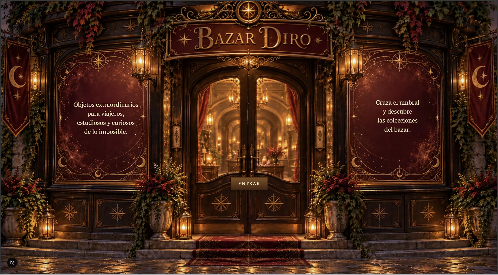
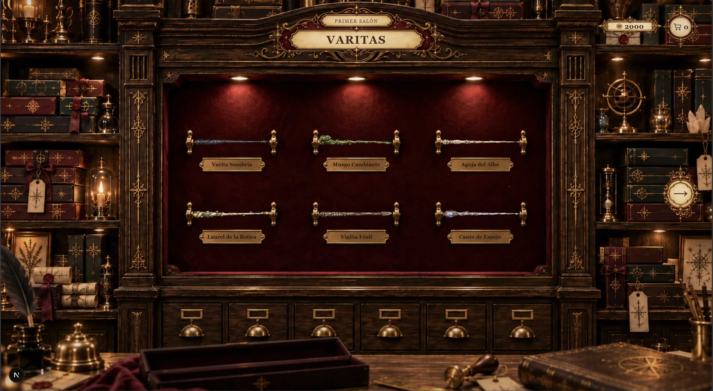
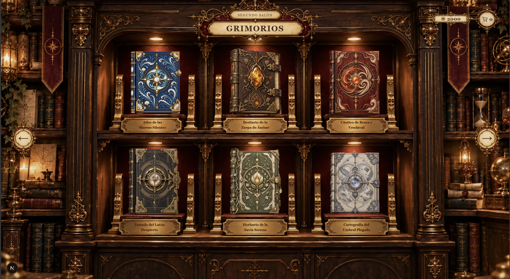
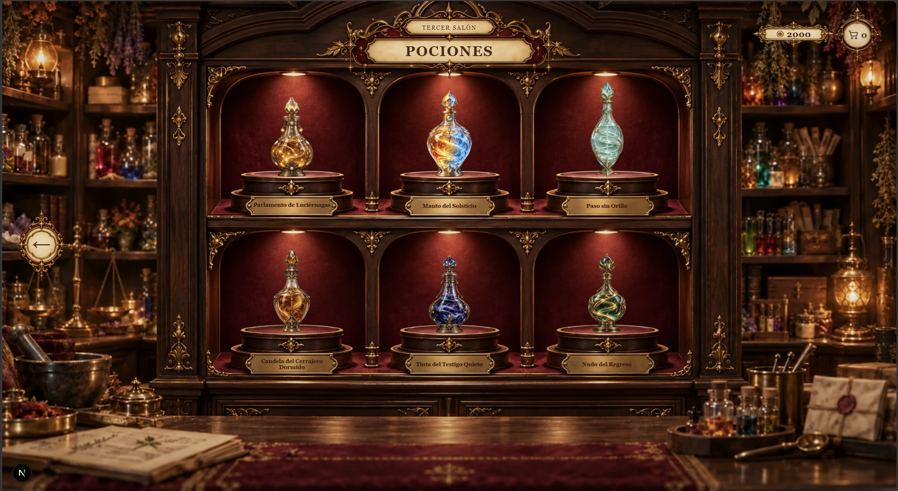
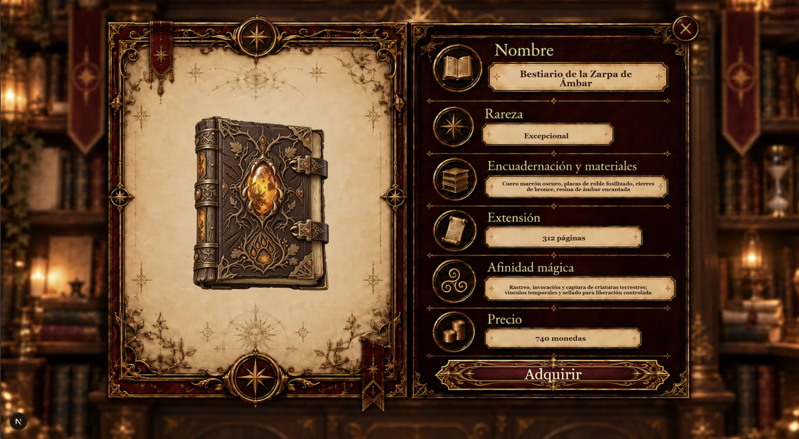
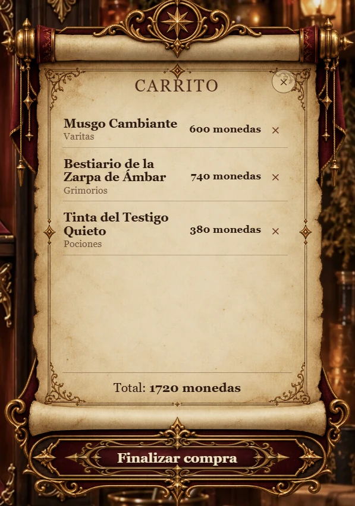

[Español](README.md) | [English](README.en.md)

# Bazar Diro

Bazar Diro is an original, desktop-first interactive fantasy shop built as a frontend practice and portfolio project. Rather than a conventional ecommerce site, it is a game-like web experience: enter through an animated exterior, travel between magical rooms, and explore a curated collection of fictional objects.

## Features

- Three themed rooms: Wands, Grimoires, and Potions
- 18 original fantasy products with typed catalog data
- Animated shop entry, room exploration, and product-detail views
- Parchment-style cart with a fictional 2,000-coin balance
- Simulated checkout flow with no real transactions
- Custom fantasy interface inspired by antique labels, brass plaques, and parchment
- Reduced-motion support and keyboard-accessible close controls where relevant

## Live Demo

[Open Bazar Diro](https://bazar-diro-web.vercel.app)

## Tech Stack

- Next.js
- React
- TypeScript
- Tailwind CSS
- Motion

## Architecture

The experience uses local, typed product data and a small global shop-state layer to coordinate room navigation, product overlays, cart contents, fictional currency, and checkout. Reusable room and detail components are paired with independent placement configurations so each scene can be composed precisely without duplicating interaction logic.

```text
src/
  app/
  components/
  data/
  types/

public/
  scenes/
  products/
  ui/
```

## Screenshots

### Entrance



The experience begins outside Bazar Diro, with an animated entrance that introduces the user to the shop and establishes its visual identity from the first interaction.

### Wands Room



The bazaar’s first room displays six original wands in an interactive showcase, with room navigation, a coin counter and access to the shopping cart.

### Grimoires Room



The second room presents a collection of grimoires with their own designs, names and attributes while preserving a consistent visual system across the shop.

### Potions Room



The apothecary features six original potions in a purpose-built display, completing the bazaar’s three main product categories.

### Product Detail



Every object has its own detail view with dynamic information about rarity, materials, magical properties and price, integrated into a category-specific scene.

### Cart

<p align="center">
  
</p>

Selected products are gathered in a parchment-style cart. The system tracks the available balance, prevents duplicates and leads into a simulated checkout flow.

### Purchase Summary

<p align="center">
  
</p>

Before completing the experience, the user can review the selected items and total cost in a checkout summary designed to match the bazaar’s visual language.

## Future Improvements

- Interactive 360° product inspection
- Improved mobile responsiveness
- Optional ambient audio

## Disclaimer

Bazar Diro is a personal practice and portfolio project. All products, currency, and purchase interactions are fictional; it is not a real commercial store.
