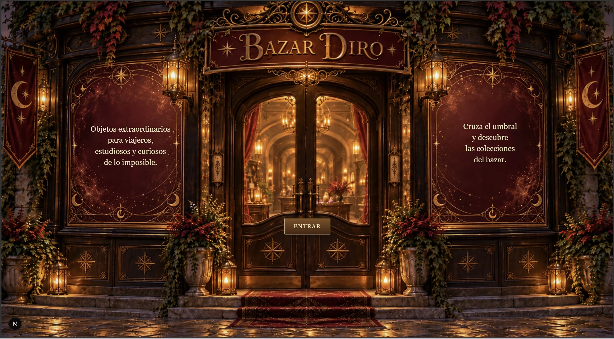
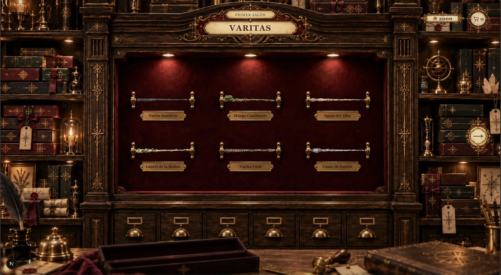
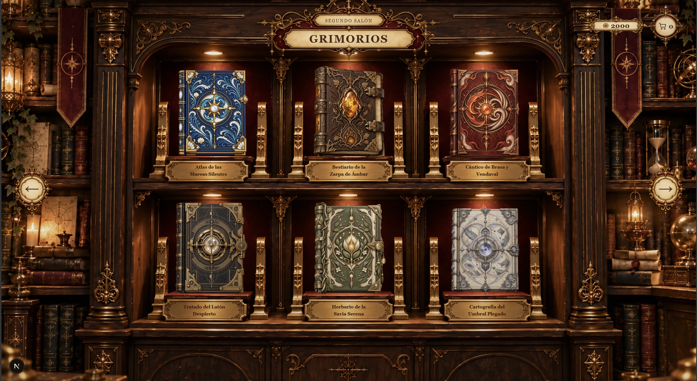
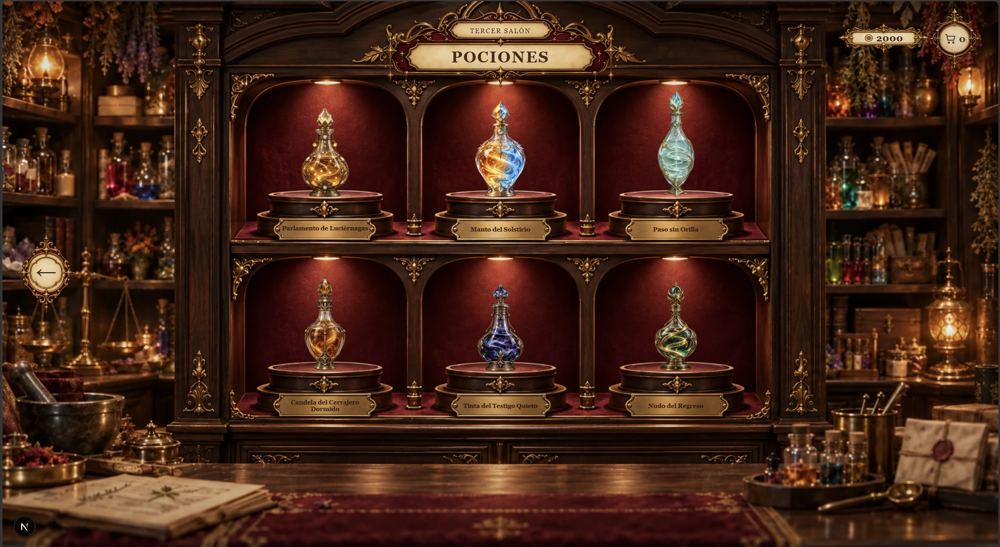
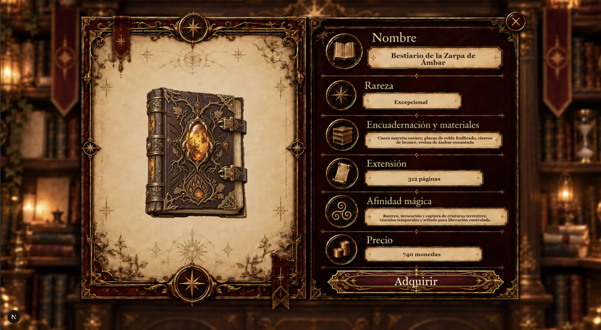
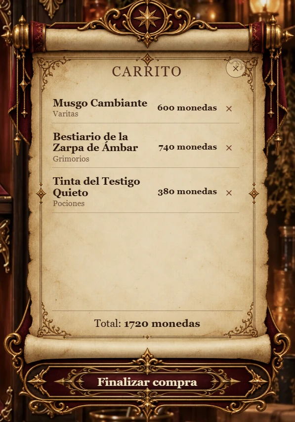

[Español](README.md) | [English](README.en.md)

# Bazar Diro

Bazar Diro es una tienda de fantasía interactiva, original y diseñada principalmente para escritorio, creada como proyecto de práctica de frontend y de portfolio. En lugar de un sitio web de comercio electrónico convencional, es una experiencia web con un enfoque de videojuego: entra a través de un exterior animado, viaja entre salas mágicas y explora una colección seleccionada de objetos ficticios.

## Características

- Tres salas temáticas: Varitas, Grimorios y Pociones
- 18 productos de fantasía originales con datos de catálogo tipados
- Entrada a la tienda, exploración de salas y vistas de detalle de producto animadas
- Carrito con estilo de pergamino y un saldo ficticio de 2.000 monedas
- Flujo de compra simulado sin transacciones reales
- Interfaz de fantasía personalizada inspirada en etiquetas antiguas, placas de latón y pergamino
- Compatibilidad con movimiento reducido y controles de cierre accesibles mediante teclado cuando procede

## Tecnologías

- Next.js
- React
- TypeScript
- Tailwind CSS
- Motion

## Arquitectura

La experiencia utiliza datos de productos locales y tipados, junto con una pequeña capa de estado global de la tienda para coordinar la navegación entre salas, las superposiciones de productos, el contenido del carrito, la moneda ficticia y la compra. Los componentes reutilizables de salas y detalles se combinan con configuraciones de colocación independientes, de modo que cada escena puede componerse con precisión sin duplicar la lógica de interacción.

```text
src/
  app/
  components/
  data/
  types/

public/
  scenes/
  products/
  ui/
```

## Demo

[Ver Bazar Diro en vivo](https://bazar-diro-web.vercel.app)

## Capturas de pantalla

### Entrada



La experiencia comienza en el exterior de Bazar Diro, con una entrada animada que introduce al usuario en la tienda y establece desde el primer momento su identidad visual.

### Sala de Varitas



Primer salón del bazar: seis varitas originales presentadas en una vitrina interactiva, con navegación entre salas, contador de monedas y acceso al carrito.

### Sala de Grimorios



El segundo salón presenta una colección de grimorios con diseños, nombres y atributos propios, manteniendo un sistema visual coherente con el resto de la tienda.

### Sala de Pociones



La botica reúne seis pociones originales en un expositor diseñado específicamente para la experiencia, completando las tres categorías principales del bazar.

### Detalle de producto



Cada objeto dispone de una ficha propia con información dinámica sobre rareza, materiales, propiedades y precio, integrada en una escena específica para cada categoría.

### Carrito

<p align="center">
  
</p>

Los productos seleccionados se reúnen en un carrito con estética de pergamino. El sistema controla el saldo disponible, evita duplicados y permite continuar hacia una compra simulada.

### Resumen de compra

<p align="center">
  
</p>

Antes de finalizar, el usuario puede revisar su selección y el coste total en un resumen de compra integrado en la estética del bazar.

## Mejoras futuras

- Inspección interactiva de productos en 360°
- Mejoras en la adaptación a dispositivos móviles
- Audio ambiental opcional

## Aviso

Bazar Diro es un proyecto personal de práctica y portfolio. Todos los productos, la moneda y las interacciones de compra son ficticios; no es una tienda comercial real.
